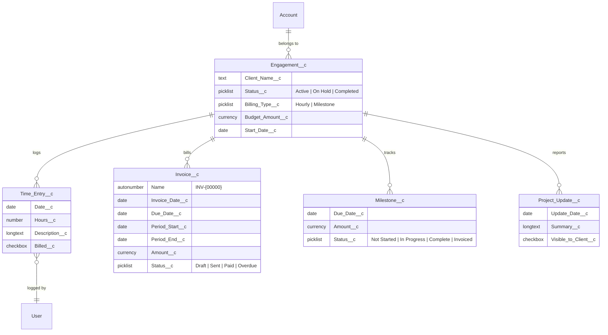

# Coqui SF Billing Engine

**A Salesforce billing and engagement-tracking engine for consulting firms — built with Apex, Lightning Web Components, and Flow.**

This is the open showcase of the internal system that runs [Coqui Consulting LLC](https://cqconsulting.net): engagement lifecycle, time tracking, hourly and milestone billing, budget guardrails, and client-visible status reporting — implemented as source-driven Salesforce DX and delivered through a reviewed pull-request pipeline.

> **Note:** all seed data in this repo is fictional. Real engagement data lives only in the operating org, never in source. Billing rates are parameterized through a custom metadata type — no rate is hardcoded anywhere in the codebase, and the only rate committed here is a `100.00` placeholder so a scratch org runs out of the box.

---

## What It Does

- **Engagement lifecycle** — every SOW becomes an `Engagement__c` record that anchors all time, invoice, milestone, and status activity. Each engagement is either `Hourly` or `Milestone` billing type, and that choice drives which billing path applies.
- **Time tracking** — consultants log `Time_Entry__c` records against an engagement, each with hours, a date, and a description.
- **Hourly billing** — a scheduled Flow rolls every unbilled time entry in the period into one draft `Invoice__c` per engagement, priced from the currently effective rate, and flags those entries `Billed__c` in the same transaction.
- **Milestone billing** — marking a `Milestone__c` Complete generates its invoice immediately and moves the milestone to `Invoiced`.
- **Budget guardrails** — every invoice insert/update re-evaluates the parent engagement's utilization against `Budget_Amount__c` and opens a Task at 80% and again at 100%, skipping engagements that already have an open alert at that severity.
- **Overdue handling** — a daily Flow moves any `Sent` invoice past its due date to `Overdue`.
- **Client-visible reporting** — `Project_Update__c` records flagged `Visible_to_Client__c` surface in a feed component; internal notes stay internal.

## Data Model



`Billing_Setting__mdt` is a custom metadata type rather than a data record, so it isn't shown above. It holds the hourly `Rate__c` keyed by `Effective_Date__c`; `InvoiceCalculator` reads the latest record effective on or before the invoice period end.

## Components

| Layer           | Component                                                                                                         | What it does                                                                                                                                                                                                                                                                                                              |
| --------------- | ----------------------------------------------------------------------------------------------------------------- | ------------------------------------------------------------------------------------------------------------------------------------------------------------------------------------------------------------------------------------------------------------------------------------------------------------------------- |
| Apex            | `InvoiceCalculator`                                                                                               | Core billing logic. `generateBiweeklyInvoices` aggregates unbilled `Time_Entry__c` records for Hourly engagements into one invoice each and marks the entries billed; `generateMilestoneInvoices` bills completed milestones; `getCurrentRate` resolves the effective rate and throws rather than silently billing at $0. |
| Apex            | `BudgetAlertTrigger` + `BudgetAlertTriggerHandler`                                                                | Trigger on `Invoice__c` (after insert/update). Aggregates non-Draft invoice totals per engagement, compares against `Budget_Amount__c`, and opens a Task at the 80% and 100% thresholds — deduplicated against existing open alerts of the same severity.                                                                 |
| Apex            | `GenerateBiweeklyInvoicesAction`, `GenerateMilestoneInvoiceAction`                                                | `@InvocableMethod` wrappers that let the Flows call into `InvoiceCalculator` without embedding billing logic in Flow.                                                                                                                                                                                                     |
| Apex            | `BudgetGaugeController`, `InvoiceHistoryController`, `MilestoneTimelineController`, `ProjectUpdateFeedController` | `@AuraEnabled(cacheable=true)` read controllers backing the four LWCs.                                                                                                                                                                                                                                                    |
| Apex            | 8 test classes, 25 test methods                                                                                   | Bulk patterns (200 time entries across 4 engagements), negative cases, and assertion messages on every assert. Run with `sf apex run test`.                                                                                                                                                                               |
| Custom Metadata | `Billing_Setting__mdt`                                                                                            | `Rate__c` + `Effective_Date__c`. Rate configuration lives here, never in code; this repo ships one placeholder record.                                                                                                                                                                                                    |
| Flow            | `BiWeeklyInvoiceFlow`                                                                                             | Scheduled weekly, gated to alternate weeks, calling `GenerateBiweeklyInvoicesAction`.                                                                                                                                                                                                                                     |
| Flow            | `MilestoneStatusFlow`                                                                                             | Record-triggered on `Milestone__c` update: invoices milestones that reach Complete.                                                                                                                                                                                                                                       |
| Flow            | `OverdueInvoiceFlow`                                                                                              | Scheduled daily: flips `Sent` invoices past due date to `Overdue`.                                                                                                                                                                                                                                                        |
| Flow            | `LeadConversionFlow`                                                                                              | Record-triggered on Opportunity creation with an Account: spins up the matching `Engagement__c` with client name, account, start date, and defaults.                                                                                                                                                                      |
| LWC             | `milestoneTimeline`                                                                                               | Milestone list with status-colored badges on the engagement record page.                                                                                                                                                                                                                                                  |
| LWC             | `projectUpdateFeed`                                                                                               | Chronological feed of client-visible project updates.                                                                                                                                                                                                                                                                     |
| LWC             | `budgetGauge`                                                                                                     | Billed-vs-budget progress bar that recolors at the same 80%/100% thresholds the trigger uses.                                                                                                                                                                                                                             |
| LWC             | `invoiceHistoryPanel`                                                                                             | Invoice list with status badges, sortable by date or amount.                                                                                                                                                                                                                                                              |
| Platform        | `Billing_Engine_User` / `Billing_Engine_Admin` permission sets, custom tabs, Lightning app                        | Deployable access model and navigation for the four custom objects.                                                                                                                                                                                                                                                       |

## Design Decisions

A few deliberate calls worth knowing about before extending this:

- **`BudgetAlertTrigger` fires on `Invoice__c`, not `Time_Entry__c`.** Budget utilization is computed from billed (non-Draft) invoice totals, so only an invoice change can actually move an engagement across a threshold. Triggering on time entries would burn CPU re-evaluating a number that hadn't changed.
- **Rates are custom metadata, not constants.** `Billing_Setting__mdt` makes a rate change configuration rather than a deployment, keeps commercial terms out of source control, and lets the same codebase serve any firm's rates. `getCurrentRate` throws when no record is effective — failing loudly beats invoicing a client for $0.
- **Idempotent billing via `Billed__c`.** The calculator marks entries billed inside the same transaction that creates the invoice, so a re-run of the scheduled Flow can't double-bill a period.
- **`InvoiceCalculator.getCurrentRate` has a `@TestVisible` override seam.** Custom Metadata Type records can't be created via DML, including in Apex tests, so tests stub the rate through `testRateOverride` instead of depending on a deployed record. The real lookup path is therefore only exercised in a scratch org — flagged here rather than hidden.
- **`BiWeeklyInvoiceFlow` runs weekly, not biweekly.** Scheduled-Triggered Flows only support Once/Daily/Weekly recurrence, so it runs every week and skips alternate weeks via a modulo formula — the standard workaround for that platform limit.
- **`LeadConversionFlow` triggers on Opportunity creation, not lead conversion.** Standard lead conversion doesn't fire its own distinct platform event, but it does reliably create an Opportunity with an Account attached, which is what the Flow keys off.
- **The four LWCs aren't pre-placed on a page layout.** Each declares `lightning__RecordPage` in its `js-meta.xml`, so an admin drags them onto the Engagement record page after deploy. Shipping a hand-built FlexiPage was a deliberate scope call, not an oversight.
- **Declarative where declarative wins.** Scheduling, record-triggered transitions, and status updates are Flow; aggregation math and idempotency guarantees are Apex, reached through invocable actions.

## Quick Start (scratch org)

```bash
git clone https://github.com/coqui-consulting/coqui-sf-billing-engine
cd coqui-sf-billing-engine

sf org login web --alias devhub --set-default-dev-hub
sf org create scratch -f config/project-scratch-def.json -a billing-demo -d 7
sf project deploy start -o billing-demo

# fictional demo data (invented companies, round amounts)
sf apex run -f scripts/seed-fictional.apex -o billing-demo

sf org open -o billing-demo
```

Run the tests:

```bash
sf apex run test -o billing-demo --code-coverage --result-format human
```

Two manual steps after deploy, both in Setup:

1. **Object Manager → Engagement → Lightning Record Pages** — drag `milestoneTimeline`, `projectUpdateFeed`, `budgetGauge`, and `invoiceHistoryPanel` onto the page and activate it.
2. **Permission sets** — assign yourself `Billing_Engine_Admin`.

The placeholder `Billing_Setting__mdt` record deploys with the project, so invoice generation works immediately without further setup.

## About

Built and maintained by **Jason Whitehead** — Salesforce Certified Platform Developer I, [Coqui Consulting LLC](https://cqconsulting.net) (North Texas).

This repo is the sanitized public mirror of the firm's operating org. Development happens in an isolated cloud environment — client code never touches local hardware — and every change lands through a reviewed pull request.

**Contract & freelance inquiries:** info@cqconsulting.net · [cqconsulting.net](https://cqconsulting.net)
